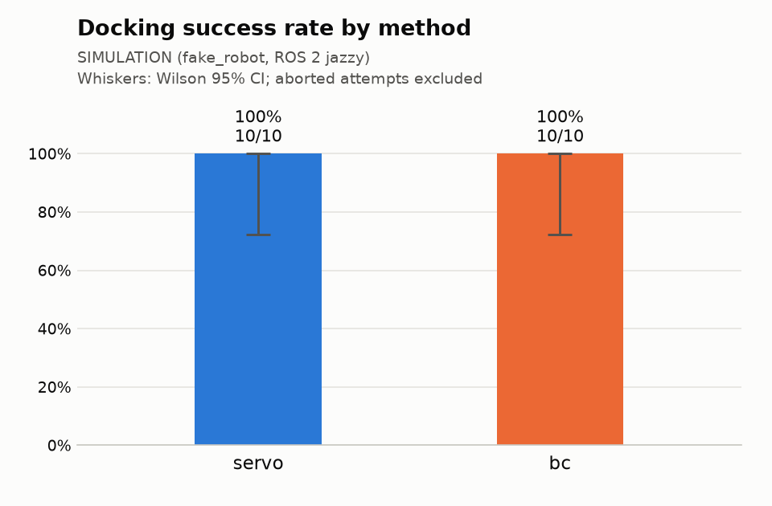

# Docking trials report

Setting: SIMULATION (fake_robot, ROS 2 jazzy).

Source: `trials.csv` (20 valid rows). Baseline: `servo`. Intervals are 95%. A trial is scored when its outcome is success or fail; success also needs zero interventions. Aborted attempts are listed below and never counted.

## Success rate

| Method | Success k/n | Success | Wilson 95% CI |
|---|---:|---:|---:|
| servo | 10/10 | 100.0% | 72.2–100.0% |
| bc | 10/10 | 100.0% | 72.2–100.0% |

## Paired comparison with `servo` (McNemar, pairs on pose_id × round)

b = servo succeeded and the method failed; c = the method succeeded and servo failed. p values are two-sided (exact binomial on b + c; mid-p per Fagerland et al. 2013). Δ = method − servo success rate over the pairs, with a paired percentile bootstrap CI (10000 resamples).

| Method | Pairs | Both succeed | Both fail | b | c | Exact p | Mid-p | Δ success | Δ 95% CI |
|---|---:|---:|---:|---:|---:|---:|---:|---:|---:|
| bc | 10 | 10 | 0 | 0 | 0 | 1 | 1 | +0.0 pp | +0.0 to +0.0 pp |

Every slot is paired.

## Time to dock and final error

| Method | Time to dock, s (successes) | Final range error, cm | Final bearing error, deg |
|---|---:|---:|---:|
| servo | 9.7 (8.5–13.5), n=10 | 3.5 (2.9–3.6), n=10 | 3.6 (3.6–3.7), n=10 |
| bc | 10.7 (8.9–13.7), n=10 | 3.8 (3.5–4.8), n=10 | 1.1 (0.9–2.1), n=10 |

Median (IQR). Time to dock = start event to the judge's end event (duration_s), so it includes the 1 s success hold. Range error = absolute difference between the final lidar range and the 0.25 m target; bearing error = absolute final marker bearing; both over all scored trials with a dock_judge reading at the end.

## Outcomes

| Method | Success | Fail: timeout | Fail: stop_obstacle | Fail: intervention | Fail: other | Abort | Interventions |
|---|---:|---:|---:|---:|---:|---:|---:|
| servo | 10 | 0 | 0 | 0 | 0 | 0 | 0 |
| bc | 10 | 0 | 0 | 0 | 0 | 0 | 0 |

## Success by start pose

| Pose | servo | bc |
|---:|---:|---:|
| 0 | 1/1 | 1/1 |
| 1 | 1/1 | 1/1 |
| 2 | 1/1 | 1/1 |
| 3 | 1/1 | 1/1 |
| 4 | 1/1 | 1/1 |
| 5 | 1/1 | 1/1 |
| 6 | 1/1 | 1/1 |
| 7 | 1/1 | 1/1 |
| 8 | 1/1 | 1/1 |
| 9 | 1/1 | 1/1 |

## Policy latency (/policy/latency)

| Source | Backend | n | Infer p50 | Infer p99 | Total p50 | Total p99 | Image age p50 | Image age p99 |
|---|---|---:|---:|---:|---:|---:|---:|---:|
| sim-cpu-onnxruntime | onnxruntime | 1214 | 20.0 | 55.1 | 26.1 | 62.5 | 37.7 | 41.2 |

Milliseconds. Infer = backend call; total = tick start to /cmd_vel_in publish (decode + preprocess + infer); image age = tick start minus the frame's capture stamp.

## Safety gate timing (/safety_gate/status)

| Source | Status msgs | Ticks | Missed deadlines | Period p50 | Period p99 | Worst p99 | Jitter p99 | Period max | Callback p99, µs | Restarts |
|---|---:|---:|---:|---:|---:|---:|---:|---:|---:|---:|
| servo | 314 | 7822 | 5 (0.064%) | 20.00 | 20.81 | 25.83 | 5.83 | 62.26 | 779 | 0 |
| bc | 347 | 8648 | 2 (0.023%) | 20.00 | 23.64 | 23.66 | 3.66 | 62.02 | 3479 | 0 |

Periods in ms; nominal 20.00 ms (rate_hz 50). A tick is a missed deadline when its period exceeds 1.5× nominal. Period p50/p99 are medians over the status windows (each covers the last ≤10000 ticks); worst p99, jitter p99 (worst p99 − nominal) and max are the worst window. Ticks and missed deadlines count only what the log covers.

## Aborted attempts

None.

## Data issues

None.
