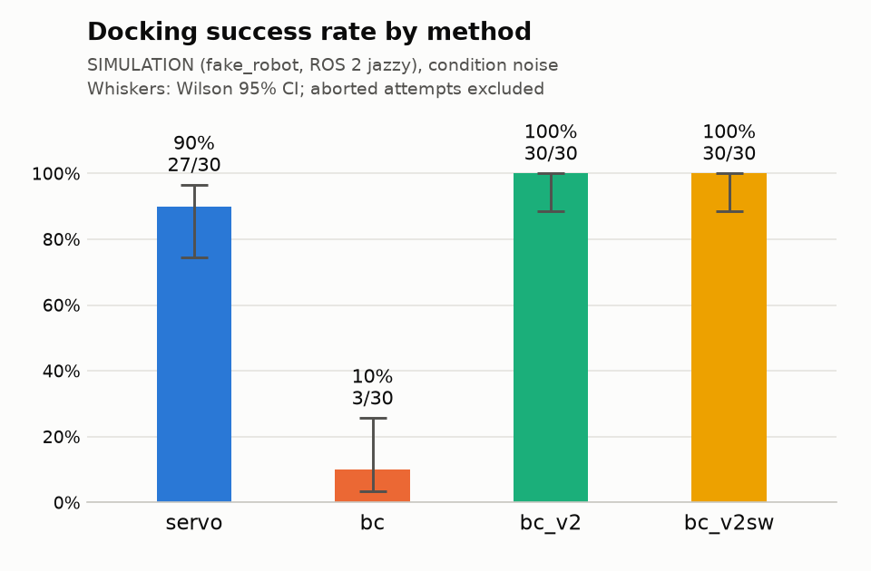

# Docking trials report

Setting: SIMULATION (fake_robot, ROS 2 jazzy), condition noise.

Source: `trials.csv` (120 valid rows). Baseline: `servo`. Intervals are 95%. A trial is scored when its outcome is success or fail; success also needs zero interventions. Aborted attempts are listed below and never counted.

## Success rate

| Method | Success k/n | Success | Wilson 95% CI |
|---|---:|---:|---:|
| servo | 27/30 | 90.0% | 74.4–96.5% |
| bc | 3/30 | 10.0% | 3.5–25.6% |
| bc_v2 | 30/30 | 100.0% | 88.6–100.0% |
| bc_v2sw | 30/30 | 100.0% | 88.6–100.0% |

## Paired comparison with `servo` (McNemar, pairs on pose_id × round)

b = servo succeeded and the method failed; c = the method succeeded and servo failed. p values are two-sided (exact binomial on b + c; mid-p per Fagerland et al. 2013). Δ = method − servo success rate over the pairs, with a Newcombe (1998, method 10) hybrid score CI for paired proportions.

| Method | Pairs | Both succeed | Both fail | b | c | Exact p | Mid-p | Δ success | Δ 95% CI |
|---|---:|---:|---:|---:|---:|---:|---:|---:|---:|
| bc | 30 | 3 | 3 | 24 | 0 | 1.19e-07 | 5.96e-08 | -80.0 pp | -89.2 to -57.9 pp |
| bc_v2 | 30 | 27 | 0 | 0 | 3 | 0.25 | 0.125 | +10.0 pp | -3.1 to +25.6 pp |
| bc_v2sw | 30 | 27 | 0 | 0 | 3 | 0.25 | 0.125 | +10.0 pp | -3.1 to +25.6 pp |

Every slot is paired.

## Time to dock and final error

| Method | Time to dock, s (successes) | Final range error, cm | Final marker bearing, deg |
|---|---:|---:|---:|
| servo | 14.8 (12.7–18.1), n=27 | 1.9 (1.8–2.0), n=30 | 3.6 (3.4–3.8), n=30 |
| bc | 13.2 (13.2–21.7), n=3 | 1.3 (0.6–2.3), n=30 | 2.0 (1.4–3.2), n=30 |
| bc_v2 | 15.1 (12.6–18.7), n=30 | 2.2 (2.1–2.6), n=30 | 2.7 (1.2–5.0), n=30 |
| bc_v2sw | 13.9 (11.9–18.1), n=30 | 2.6 (2.3–3.0), n=30 | 3.3 (1.7–5.3), n=30 |

Median (IQR). Time to dock = start event to the judge's end event (duration_s), so it includes the 1 s success hold. Range error = absolute difference between the final lidar range and the 0.25 m target; marker bearing = absolute final bearing of the marker from the image centre (not the robot's heading to the box face, which the judge does not measure); both over all scored trials with a dock_judge reading at the end.

## Outcomes

| Method | Success | Fail: timeout | Fail: stop_obstacle | Fail: intervention | Fail: other | Abort | Interventions |
|---|---:|---:|---:|---:|---:|---:|---:|
| servo | 27 | 3 | 0 | 0 | 0 | 0 | 0 |
| bc | 3 | 27 | 0 | 0 | 0 | 0 | 0 |
| bc_v2 | 30 | 0 | 0 | 0 | 0 | 0 | 0 |
| bc_v2sw | 30 | 0 | 0 | 0 | 0 | 0 | 0 |

## Success by start pose

| Pose | servo | bc | bc_v2 | bc_v2sw |
|---:|---:|---:|---:|---:|
| 0 | 3/3 | 2/3 | 3/3 | 3/3 |
| 1 | 3/3 | 0/3 | 3/3 | 3/3 |
| 2 | 3/3 | 0/3 | 3/3 | 3/3 |
| 3 | 3/3 | 0/3 | 3/3 | 3/3 |
| 4 | 3/3 | 0/3 | 3/3 | 3/3 |
| 5 | 0/3 | 0/3 | 3/3 | 3/3 |
| 6 | 3/3 | 0/3 | 3/3 | 3/3 |
| 7 | 3/3 | 1/3 | 3/3 | 3/3 |
| 8 | 3/3 | 0/3 | 3/3 | 3/3 |
| 9 | 3/3 | 0/3 | 3/3 | 3/3 |

## Schedule check

Every scheduled trial has exactly one scored result, and nothing unscheduled was scored.

## Policy latency (/policy/latency)

| Source | Backend | n | Infer p50 | Infer p99 | Total p50 | Total p99 | Image age p50 | Image age p99 |
|---|---|---:|---:|---:|---:|---:|---:|---:|
| sim-cpu-onnxruntime | onnxruntime | 4671 | 27.0 | 65.4 | 34.8 | 75.1 | 53.3 | 94.3 |
| earlier2 | onnxruntime | 4904 | 33.6 | 67.1 | 40.7 | 75.8 | 53.0 | 93.3 |

Milliseconds. Infer = backend call; total = tick start to /cmd_vel_in publish (decode + preprocess + infer); image age = tick start minus the frame's capture stamp.

## Safety gate timing (/safety_gate/status)

| Source | Status msgs | Ticks | Missed deadlines | Period p50 | Period p99 | Worst p99 | Jitter p99 | Period max | Callback p99, µs | Restarts |
|---|---:|---:|---:|---:|---:|---:|---:|---:|---:|---:|
| session | 1195 | 29805 | 41 (0.138%) | 20.00 | 25.08 | 25.37 | 5.37 | 319.41 | 4679 | 0 |
| earlier2 | 1207 | 30083 | 41 (0.136%) | 20.00 | 24.92 | 25.79 | 5.79 | 352.69 | 3258 | 0 |

Periods in ms; nominal 20.00 ms (rate_hz 50). A tick is a missed deadline when its period exceeds 1.5× nominal. Period p50/p99 are medians over the status windows (each covers the last ≤10000 ticks); worst p99, jitter p99 (worst p99 − nominal) and max are the worst window. Ticks and missed deadlines count only what the log covers.

## Aborted attempts

None.

## Data issues

None.
