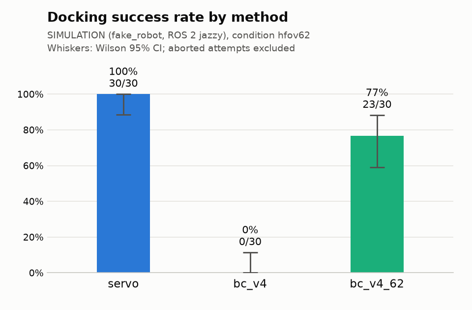

# Docking trials report

Setting: SIMULATION (fake_robot, ROS 2 jazzy), condition hfov62.

Source: `trials.csv` (90 valid rows). Baseline: `servo`. Intervals are 95%. A trial is scored when its outcome is success or fail; success also needs zero interventions. Aborted attempts are listed below and never counted.

## Success rate

| Method | Success k/n | Success | Wilson 95% CI |
|---|---:|---:|---:|
| servo | 30/30 | 100.0% | 88.6–100.0% |
| bc_v4 | 0/30 | 0.0% | 0.0–11.4% |
| bc_v4_62 | 23/30 | 76.7% | 59.1–88.2% |

## Paired comparison with `servo` (McNemar, pairs on pose_id × round)

b = servo succeeded and the method failed; c = the method succeeded and servo failed. p values are two-sided (exact binomial on b + c; mid-p per Fagerland et al. 2013). Δ = method − servo success rate over the pairs, with a Newcombe (1998, method 10) hybrid score CI for paired proportions.

| Method | Pairs | Both succeed | Both fail | b | c | Exact p | Mid-p | Δ success | Δ 95% CI |
|---|---:|---:|---:|---:|---:|---:|---:|---:|---:|
| bc_v4 | 30 | 0 | 0 | 30 | 0 | 1.86e-09 | 9.31e-10 | -100.0 pp | -100.0 to -83.9 pp |
| bc_v4_62 | 30 | 23 | 0 | 7 | 0 | 0.0156 | 0.00781 | -23.3 pp | -40.9 to -7.1 pp |

Every slot is paired.

## Time to dock and final error

| Method | Time to dock, s (successes) | Final range error, cm | Final marker bearing, deg |
|---|---:|---:|---:|
| servo | 14.6 (12.6–18.9), n=30 | 2.1 (2.0–2.2), n=30 | 3.6 (3.4–3.8), n=30 |
| bc_v4 | — | 9.9 (9.6–10.2), n=30 | 4.3 (4.0–4.6), n=30 |
| bc_v4_62 | 18.3 (15.1–23.2), n=23 | 1.9 (1.7–2.1), n=30 | 2.9 (2.3–3.7), n=30 |

Median (IQR). Time to dock = start event to the judge's end event (duration_s), so it includes the 1 s success hold. Range error = absolute difference between the final lidar range and the 0.25 m target; marker bearing = absolute final bearing of the marker from the image centre (not the robot's heading to the box face, which the judge does not measure); both over all scored trials with a dock_judge reading at the end.

## Outcomes

| Method | Success | Fail: timeout | Fail: stop_obstacle | Fail: intervention | Fail: other | Abort | Interventions |
|---|---:|---:|---:|---:|---:|---:|---:|
| servo | 30 | 0 | 0 | 0 | 0 | 0 | 0 |
| bc_v4 | 0 | 30 | 0 | 0 | 0 | 0 | 0 |
| bc_v4_62 | 23 | 7 | 0 | 0 | 0 | 0 | 0 |

## Success by start pose

| Pose | servo | bc_v4 | bc_v4_62 |
|---:|---:|---:|---:|
| 0 | 3/3 | 0/3 | 3/3 |
| 1 | 3/3 | 0/3 | 0/3 |
| 2 | 3/3 | 0/3 | 3/3 |
| 3 | 3/3 | 0/3 | 3/3 |
| 4 | 3/3 | 0/3 | 3/3 |
| 5 | 3/3 | 0/3 | 0/3 |
| 6 | 3/3 | 0/3 | 3/3 |
| 7 | 3/3 | 0/3 | 2/3 |
| 8 | 3/3 | 0/3 | 3/3 |
| 9 | 3/3 | 0/3 | 3/3 |

## Schedule check

Every scheduled trial has exactly one scored result, and nothing unscheduled was scored.

## Policy latency (/policy/latency)

| Source | Backend | n | Infer p50 | Infer p99 | Total p50 | Total p99 | Image age p50 | Image age p99 |
|---|---|---:|---:|---:|---:|---:|---:|---:|
| sim-cpu-onnxruntime | onnxruntime | 6362 | 62.2 | 115.7 | 72.6 | 132.2 | 68.5 | 193.8 |
| earlier1 | onnxruntime | 8781 | 60.5 | 116.6 | 71.8 | 134.2 | 71.3 | 192.4 |

Milliseconds. Infer = backend call; total = tick start to /cmd_vel_in publish (decode + preprocess + infer); image age = tick start minus the frame's capture stamp.

## Safety gate timing (/safety_gate/status)

| Source | Status msgs | Ticks | Missed deadlines | Period p50 | Period p99 | Worst p99 | Jitter p99 | Period max | Callback p99, µs | Restarts |
|---|---:|---:|---:|---:|---:|---:|---:|---:|---:|---:|
| session | 1554 | 38775 | 78 (0.201%) | 20.00 | 26.18 | 26.23 | 6.23 | 331.31 | 6238 | 0 |
| earlier1 | 3289 | 82066 | 94 (0.115%) | 20.00 | 25.25 | 25.85 | 5.85 | 330.50 | 3674 | 0 |

Periods in ms; nominal 20.00 ms (rate_hz 50). A tick is a missed deadline when its period exceeds 1.5× nominal. Period p50/p99 are medians over the status windows (each covers the last ≤10000 ticks); worst p99, jitter p99 (worst p99 − nominal) and max are the worst window. Ticks and missed deadlines count only what the log covers.

## Aborted attempts

None.

## Data issues

None.
