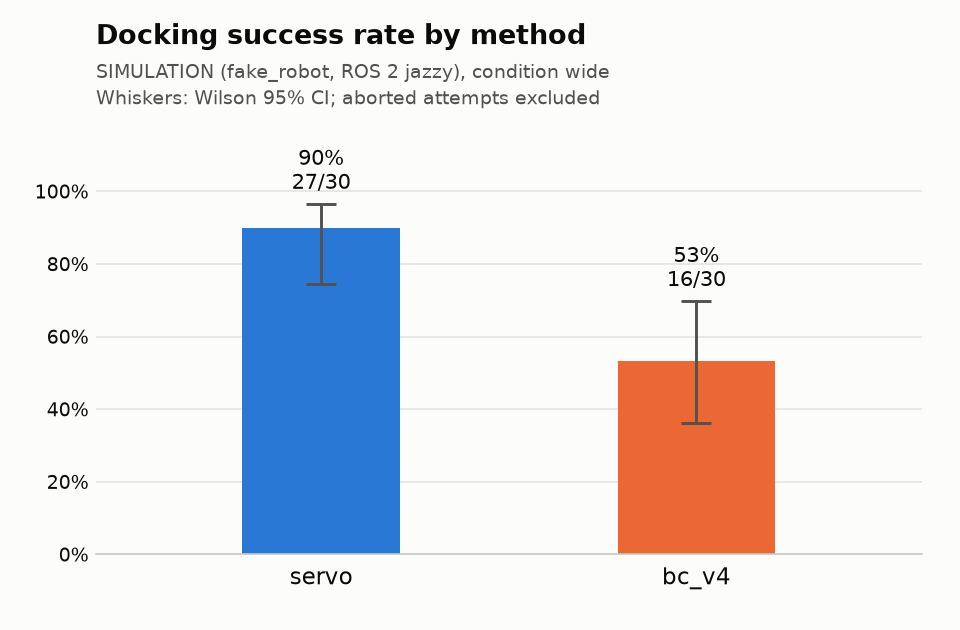

# Docking trials report

Setting: SIMULATION (fake_robot, ROS 2 jazzy), condition wide.

Source: `trials.csv` (60 valid rows). Baseline: `servo`. Intervals are 95%. A trial is scored when its outcome is success or fail; success also needs zero interventions. Aborted attempts are listed below and never counted.

## Success rate

| Method | Success k/n | Success | Wilson 95% CI |
|---|---:|---:|---:|
| servo | 27/30 | 90.0% | 74.4–96.5% |
| bc_v4 | 16/30 | 53.3% | 36.1–69.8% |

## Paired comparison with `servo` (McNemar, pairs on pose_id × round)

b = servo succeeded and the method failed; c = the method succeeded and servo failed. p values are two-sided (exact binomial on b + c; mid-p per Fagerland et al. 2013). Δ = method − servo success rate over the pairs, with a Newcombe (1998, method 10) hybrid score CI for paired proportions.

| Method | Pairs | Both succeed | Both fail | b | c | Exact p | Mid-p | Δ success | Δ 95% CI |
|---|---:|---:|---:|---:|---:|---:|---:|---:|---:|
| bc_v4 | 30 | 16 | 3 | 11 | 0 | 0.000977 | 0.000488 | -36.7 pp | -53.5 to -17.0 pp |

Every slot is paired.

## Time to dock and final error

| Method | Time to dock, s (successes) | Final range error, cm | Final marker bearing, deg |
|---|---:|---:|---:|
| servo | 20.4 (18.0–21.3), n=27 | 2.2 (2.0–2.4), n=30 | 3.6 (3.4–3.7), n=30 |
| bc_v4 | 25.0 (23.3–27.6), n=16 | 1.5 (1.4–2.1), n=30 | 3.8 (2.5–5.3), n=30 |

Median (IQR). Time to dock = start event to the judge's end event (duration_s), so it includes the 1 s success hold. Range error = absolute difference between the final lidar range and the 0.25 m target; marker bearing = absolute final bearing of the marker from the image centre (not the robot's heading to the box face, which the judge does not measure); both over all scored trials with a dock_judge reading at the end.

## Outcomes

| Method | Success | Fail: timeout | Fail: stop_obstacle | Fail: intervention | Fail: other | Abort | Interventions |
|---|---:|---:|---:|---:|---:|---:|---:|
| servo | 27 | 3 | 0 | 0 | 0 | 0 | 0 |
| bc_v4 | 16 | 14 | 0 | 0 | 0 | 0 | 0 |

## Success by start pose

| Pose | servo | bc_v4 |
|---:|---:|---:|
| 0 | 3/3 | 3/3 |
| 1 | 3/3 | 3/3 |
| 2 | 3/3 | 1/3 |
| 3 | 3/3 | 0/3 |
| 4 | 3/3 | 0/3 |
| 5 | 3/3 | 3/3 |
| 6 | 3/3 | 3/3 |
| 7 | 3/3 | 1/3 |
| 8 | 3/3 | 2/3 |
| 9 | 0/3 | 0/3 |

## Schedule check

Every scheduled trial has exactly one scored result, and nothing unscheduled was scored.

## Policy latency (/policy/latency)

| Source | Backend | n | Infer p50 | Infer p99 | Total p50 | Total p99 | Image age p50 | Image age p99 |
|---|---|---:|---:|---:|---:|---:|---:|---:|
| sim-cpu-onnxruntime | onnxruntime | 7964 | 66.2 | 119.7 | 78.3 | 136.2 | 64.1 | 192.1 |

Milliseconds. Infer = backend call; total = tick start to /cmd_vel_in publish (decode + preprocess + infer); image age = tick start minus the frame's capture stamp.

## Safety gate timing (/safety_gate/status)

| Source | Status msgs | Ticks | Missed deadlines | Period p50 | Period p99 | Worst p99 | Jitter p99 | Period max | Callback p99, µs | Restarts |
|---|---:|---:|---:|---:|---:|---:|---:|---:|---:|---:|
| session | 3451 | 85967 | 137 (0.159%) | 20.00 | 25.98 | 27.02 | 7.02 | 348.93 | 3505 | 0 |

Periods in ms; nominal 20.00 ms (rate_hz 50). A tick is a missed deadline when its period exceeds 1.5× nominal. Period p50/p99 are medians over the status windows (each covers the last ≤10000 ticks); worst p99, jitter p99 (worst p99 − nominal) and max are the worst window. Ticks and missed deadlines count only what the log covers.

## Aborted attempts

None.

## Data issues

None.
